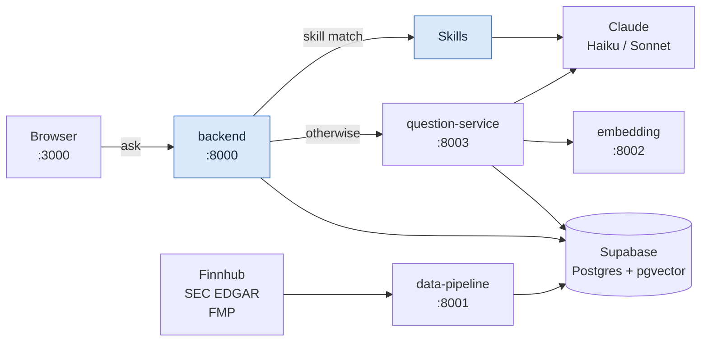
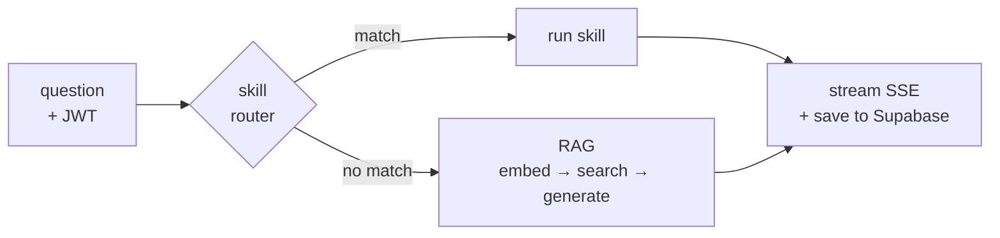

# QuantAgent

Financial research assistant: daily briefings, watchlist management, RAG-based
Q&A over SEC filings and news, and on-demand ticker research reports.

**One monorepo for the whole system** — every service and shared library lives
here. `./dev.sh` installs everything and tells you exactly what is still
missing.

```bash
git clone https://github.com/ZeroNoise2026/QuantAgent.git
cd QuantAgent && ./dev.sh
```

That one command creates a venv per service, scaffolds every `.env`, and prints
a readiness report. Then fill in your credentials (`./dev.sh secrets`) and
`./dev.sh up`.

## Architecture



Blue is this repo. The backend authenticates, keeps the conversation, and picks
**skill or RAG** — nothing else lives here.

**One chat request:**



**One ingestion run:** `data-pipeline` pulls news, filings and quotes → cleans →
chunks → embeds via `:8002` → upserts into Supabase. Nothing else writes those
tables.

| Tables | Owner |
|---|---|
| `documents` `earnings` `price_snapshot` `tracked_tickers` | data-pipeline |
| `chat_sessions` `chat_messages` `user_files` `user_watchlist` `user_preferences` `daily_briefings` | backend |
| `summary_cache` | Summarization |

Schema for the shared tables lives in `apps/pipeline/pipeline/schema.sql`;
`apps/backend/migrations/` owns the user-scoped ones and their RLS policies.

## The system

One repo, several independently deployed services.

| Path | Role | Port |
|---|---|---|
| `apps/web` | React UI | 3000 |
| `apps/backend` | FastAPI BFF. Auth, watchlist, briefings, chat. | 8000 |
| `apps/summarization` | `summary` CLI (research reports) + `question` service (RAG Q&A) | 8003 |
| `apps/pipeline` | Ingest Finnhub / SEC EDGAR / FMP → clean → chunk → embed → Supabase | 8001 |
| `apps/embedding` | all-MiniLM-L6-v2, 384-dim vectors | 8002 |
| `libs/skills` | Shared skill framework (`generate_report`, `compare_tickers`) | — |

**Rule: apps never import each other.** Code that two apps need goes in
`libs/`. Apps talk to each other only over HTTP. (Known exception, to be
removed: `libs/skills` still reaches into `apps/summarization` for
`generate_report` and `compare_tickers`.)

The voice assistant is deliberately **not** in this repo: it is a generic
module in its own repo (`voiceAI-plugin`) and talks to the backend over HTTP.

## Layout

```
QuantAgent/
├── dev.sh  deploy.sh         local stack + Cloud Run deploys
├── .github/workflows/        CI and scheduled jobs for every app
├── docs/                     DEPLOY.md, architecture.html
├── libs/
│   └── skills/               shared skill framework
└── apps/
    ├── backend/              FastAPI BFF
    │   ├── main.py           API server; routes skills before falling back to RAG
    │   ├── rag.py            proxies the question-service SSE stream
    │   ├── briefing.py       scheduled daily briefing generator
    │   ├── summarizer.py     Claude client for summaries + briefings
    │   ├── fetcher.py        TickerContext assembly from Supabase
    │   ├── db.py             Supabase data access
    │   ├── auth.py           Supabase JWT verification
    │   ├── files/            upload, parse and preview (pdf/docx/xlsx/csv/txt)
    │   └── migrations/       SQL migrations
    ├── web/                  React + Vite (src/pages: Chat, Briefing, Watchlist, Login, Signup)
    ├── summarization/        question service + summary CLI
    ├── pipeline/             ingestion + live-lookup API
    └── embedding/            embedding API
```

## API

| Method | Path | Description |
|---|---|---|
| GET | `/api/tickers` | Tickers available for the watchlist |
| GET/POST | `/api/watchlist` | Read / add |
| DELETE | `/api/watchlist/{ticker}` | Remove |
| GET/PUT | `/api/preferences` | Timezone, briefing toggle |
| GET | `/api/briefings` · `/latest` · `/by-date` · `/dates` | Briefing history |
| POST | `/api/briefings/refresh` | Generate one now for the watchlist |
| POST | `/api/chat/stream` | SSE chat — skill routing, then RAG |
| GET/DELETE | `/api/chat/sessions` | Session list / bulk delete |
| GET | `/api/chat/sessions/{id}/messages` | Session transcript |
| POST | `/api/summarize` | On-demand ticker report |
| — | `/api/files/...` | Upload, list, preview, download, attach, delete |
| GET | `/health` | Liveness |

The frontend dev server proxies `/api` to `http://localhost:8000`, so no CORS
configuration is needed locally. In production set `ALLOWED_ORIGINS`.

## Authentication

Supabase Auth (email + password). Every backend route requires
`Authorization: Bearer <jwt>`.

One-time Supabase setup:

1. **Authentication → Providers → Email**: enable.
2. **Authentication → Settings → Confirm email**: off for dev, otherwise users
   cannot log in until they click the confirmation mail.
3. **Project Settings → API → JWT Settings**: copy the JWT Secret into
   `backend/.env` as `SUPABASE_JWT_SECRET`.
4. Run `backend/migrations/002_auth_uuid_rls.sql` in the SQL editor.
   ⚠️ It **TRUNCATEs** `chat_sessions`, `chat_messages`, `user_watchlist`,
   `user_preferences`, `daily_briefings` — the old localStorage user ids cannot
   be mapped onto real `auth.users.id` rows.

Database schema lives in `apps/pipeline/pipeline/schema.sql` (single source
of truth for every table in the project).

## Credentials

Shared credentials live in **one** file outside every repo,
`~/.config/quantagent/secrets.env` (override with `QUANT_SECRETS_FILE`). Edit
only that file; `./dev.sh setup` and `up` copy its values into each
service `.env` automatically.

```bash
./dev.sh secrets init    # first time: seed it from the .env files you already have
./dev.sh secrets         # what is set (values masked)
./dev.sh secrets pull    # new machine: rebuild it from GCP Secret Manager
```

Per-service `.env` files (written by `./dev.sh setup`) still hold
service-specific config such as model names. The keys each one needs:

| Where | Keys |
|---|---|
| `apps/backend/.env` | `SUPABASE_URL` `SUPABASE_KEY` `SUPABASE_JWT_SECRET` `ANTHROPIC_API_KEY` |
| `apps/web/.env.local` | `VITE_SUPABASE_URL` `VITE_SUPABASE_PUBLISHABLE_KEY` |
| `apps/summarization/.env` | `SUPABASE_URL` `SUPABASE_KEY` `ANTHROPIC_API_KEY` |
| `apps/pipeline/.env` | `SUPABASE_URL` `SUPABASE_KEY` `FINNHUB_API_KEY` `FMP_API_KEY` `EDGAR_USER_AGENT` |
| `apps/embedding/.env` | none required |

Supabase values: Dashboard → Project Settings → API (the JWT secret is under
API → JWT Settings). `SUPABASE_KEY` is the **service-role** key — server-side
only, it bypasses RLS.

`./dev.sh doctor` treats placeholder values (`sk-xxxxxxxx`,
`your-supabase-service-role-key`) as missing, so copying `.env.example` by hand
will not fool it.

## Deployment

`./deploy.sh` builds and deploys each service to Cloud Run — see
[docs/DEPLOY.md](docs/DEPLOY.md). `apps/backend/Dockerfile` builds from the
repo root so it can install `libs/skills`; without it, skill routing silently
degrades to RAG on every request.

## dev.sh

```bash
./dev.sh                 # setup + doctor  (idempotent, start here)
./dev.sh sync            # git pull --ff-only
./dev.sh setup [svc...]  # venvs, deps, .env scaffolding
./dev.sh doctor          # what is ready, what is blocked, and why
./dev.sh test            # offline suites — zero credentials needed
./dev.sh up [svc...]     # start services; refuses any with missing credentials
./dev.sh down / status / logs <svc>
```

Services: `embedding` `pipeline` `question` `backend` `frontend`.

Notes on behaviour that surprises people:

- **One venv per service, not one shared.** Summarization pins
  `fastapi==0.104.1` / `pydantic==2.5.0`; this backend is unpinned. A shared
  venv silently breaks one of them.
- **`up` refuses to start a service whose credentials are missing**, instead of
  starting it and dying inside a stack trace.
- **`.env` scaffolding keeps real defaults and empties only placeholders.**
  Blanking everything would break `apps/embedding`, whose config does
  `int(os.getenv("EMBEDDING_DIM", "384"))` — a present-but-empty var is not the
  default, it is `int("")`. Existing `.env` files are never overwritten.
- `dev.sh` installs `libs/skills` **editable** into the backend venv, so edits
  there take effect without a reinstall.

## Running without dev.sh

```bash
cd apps/backend
python3 -m venv venv && source venv/bin/activate
pip install -r requirements.txt -e ../../libs/skills
uvicorn main:app --port 8000 --reload

cd ../web
npm install && npm run dev          # http://localhost:3000
```

The briefing job runs hourly via GitHub Actions and generates a briefing when a
user's local time is 08:00–08:14; test it with `python apps/backend/briefing.py`.
