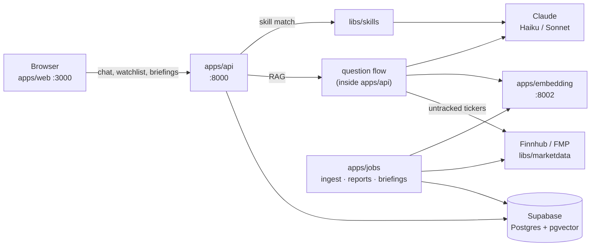

# ZeroNoise

Financial research assistant: daily briefings, watchlist management, RAG-based
Q&A over SEC filings and news, and on-demand ticker research reports — powered
by Claude.

One monorepo, one `.env`, two long-running services (API + embedding), one
set of batch jobs.

## Quick start

```bash
git clone https://github.com/ZeroNoise2026/QuantAgent.git zeroNoise
cd zeroNoise
./dev.sh              # venvs + deps, scaffolds .env, readiness report
$EDITOR .env          # fill in the empty credentials (see Configuration)
./dev.sh up           # start embedding, api and the web app
```

Then open http://localhost:3000. `./dev.sh doctor` tells you exactly what is
still missing at any point.

## Architecture



**One chat request:** the API verifies the Supabase JWT, asks the skill router
whether a skill fits, and otherwise runs the RAG question flow in-process; the
answer streams back over SSE and is saved with its citations.

**One ingestion run:** the ingest job pulls news, filings and quotes → cleans →
chunks → embeds via `:8002` → upserts into Supabase. Nothing else writes those
tables.

**Models.** Haiku 5.5 handles chat answers, routing, structured JSON, short
summaries and briefings; Sonnet 5.5 writes the research reports. Every call
goes through the single client in `libs/common`.

## Layout

```
zeroNoise/
├── .env.example          the one config template (copy to .env)
├── dev.sh  deploy.sh     local stack · Cloud Run deploys
├── .github/workflows/    CI + scheduled jobs
├── docs/                 DEPLOY.md, architecture.html
├── scripts/              check_boundaries.py
├── apps/
│   ├── api/              FastAPI :8000 — auth, user data, chat, RAG question flow
│   ├── web/              React + Vite :3000
│   ├── embedding/        all-MiniLM-L6-v2 vectors :8002
│   └── jobs/             batch: ingest, reports, briefings, cache cleanup
└── libs/
    ├── common/           Claude client, Supabase client, audit log
    ├── research/         ticker context, reports + cache, briefings, market-data reads
    ├── skills/           skill framework: registry, LLM router, built-in skills
    └── marketdata/       Finnhub / FMP / SEC EDGAR clients
```

Each directory has its own README: [apps/api](apps/api/README.md),
[apps/jobs](apps/jobs/README.md), [apps/embedding](apps/embedding/README.md),
[libs/skills](libs/skills/README.md).

### Module boundaries

**Apps never import each other, and libs never import apps.** Code two apps
need goes in `libs/`; apps talk to each other only over HTTP.
`scripts/check_boundaries.py` enforces this in CI and in `./dev.sh test`.

| Lib | Used by | Owns |
|---|---|---|
| `libs/common` | everything Python | `common.llm` (chat, streaming, retries, refusal handling, audit), `common.supabase`, `common.audit` |
| `libs/research` | api, jobs, skills | market-data reads, `TickerContext`, `build_report()` + `summary_cache`, `build_briefing()` + `daily_briefings` |
| `libs/skills` | api, jobs | `Skill` base, registry, router; `generate_report`, `compare_tickers` |
| `libs/marketdata` | api, jobs | `FinnhubClient`, `FMPClient`, `EdgarClient`, retry/backoff |

## Configuration

Everything lives in **one file: `.env` at the repo root** (gitignored).
`./dev.sh setup` creates it from `.env.example`, keeping real defaults and
leaving placeholders empty. Every Python app's `config.py` loads it; the web
app reads it through Vite's `envDir` (only `VITE_*` keys reach the browser).
In Cloud Run the same keys are injected by `deploy.sh`.

| Key | Needed by |
|---|---|
| `ANTHROPIC_API_KEY` | api, jobs |
| `SUPABASE_URL` `SUPABASE_KEY` | api, jobs |
| `SUPABASE_JWT_SECRET` | api |
| `FINNHUB_API_KEY` `FMP_API_KEY` `EDGAR_USER_AGENT` | jobs (ingest), api (live lookups) |
| `VITE_SUPABASE_URL` `VITE_SUPABASE_PUBLISHABLE_KEY` | web |
| `LLM_MODEL` · `LLM_MODEL_SUMMARY` · `LLM_MODEL_QA` · `LLM_MODEL_CLASSIFY` | summaries & briefings · reports · chat · router (defaults in `.env.example`) |

Supabase values are under Dashboard → Project Settings → API. `SUPABASE_KEY`
is the **service-role** key — server-side only, it bypasses RLS.

```bash
./dev.sh env          # which required keys are set (values masked)
./dev.sh env pull     # new machine: fill the secrets in from GCP Secret Manager
```

## API

| Method | Path | Description |
|---|---|---|
| GET | `/api/tickers` | Tickers available for the watchlist |
| GET/POST | `/api/watchlist` | Read / add |
| DELETE | `/api/watchlist/{ticker}` | Remove |
| GET/PUT | `/api/preferences` | Timezone, briefing toggle |
| GET | `/api/briefings` · `/latest` · `/by-date` · `/dates` | Briefing history |
| POST | `/api/briefings/refresh` | Generate one now for the watchlist |
| POST | `/api/chat/stream` | SSE chat — skill routing, then RAG |
| GET/DELETE | `/api/chat/sessions` | Session list / bulk delete |
| GET | `/api/chat/sessions/{id}/messages` | Session transcript |
| POST | `/api/summarize` | On-demand ticker summary |
| — | `/api/files/...` | Upload, list, preview, download, attach, delete |
| GET | `/health` | Liveness |

Every route except `/health` requires `Authorization: Bearer <supabase jwt>`.
The web dev server proxies `/api` to `http://localhost:8000`, so no CORS setup
is needed locally; in production set `ALLOWED_ORIGINS`.

## Data

| Tables | Written by |
|---|---|
| `documents` `earnings` `price_snapshot` `tracked_tickers` | apps/jobs (ingest) |
| `chat_sessions` `chat_messages` `user_files` `user_watchlist` `user_preferences` | apps/api |
| `daily_briefings` `summary_cache` | libs/research (api + jobs) |
| `api_audit_log` | libs/common |

Every table's DDL: `apps/jobs/pipeline/schema.sql`. User-scoped RLS
policies: `apps/api/migrations/`.

### One-time Supabase auth setup

1. **Authentication → Providers → Email**: enable.
2. **Authentication → Settings → Confirm email**: off for dev, otherwise users
   cannot log in until they click the confirmation mail.
3. **Project Settings → API → JWT Settings**: copy the JWT secret into `.env`
   as `SUPABASE_JWT_SECRET`.
4. Run `apps/api/migrations/002_auth_uuid_rls.sql` in the SQL editor.
   ⚠️ It **TRUNCATEs** `chat_sessions`, `chat_messages`, `user_watchlist`,
   `user_preferences`, `daily_briefings`.

## Development

```bash
./dev.sh                 # setup + doctor (idempotent, start here)
./dev.sh setup [svc...]  # venvs, deps, editable libs, .env scaffold
./dev.sh doctor          # what is ready, what is blocked, and why
./dev.sh up [svc...]     # start services; refuses any with missing credentials
./dev.sh down / status / logs <svc>
./dev.sh job <name>      # ingest | reports | briefing | cleanup
./dev.sh test            # every offline suite + boundary check, zero credentials
./dev.sh sync            # git pull --ff-only
```

Services: `embedding` `api` `frontend`; `jobs` is set up too but only runs on
demand.

- **One venv per app.** Libs are installed **editable** into each venv that
  needs them, so edits take effect without a reinstall.
- **`up` refuses to start a service whose credentials are missing** instead of
  letting it die in a stack trace.
- **`.env` scaffolding never overwrites** an existing `.env`, and treats
  placeholders (`sk-xxxxxxxx`, `your-…`, `<…>`) as missing.

```bash
./dev.sh job reports --ticker AAPL                          # research report → apps/jobs/output/
./dev.sh job reports --skill compare_tickers --args '{"tickers":["AAPL","MSFT"]}'
./dev.sh job ingest --ticker AAPL --dry-run                 # needs ./dev.sh up embedding
```

## Deployment

`./deploy.sh` builds `api` and `embedding` and deploys them to Cloud Run,
wiring service URLs and mounting secrets from Secret Manager — see
[docs/DEPLOY.md](docs/DEPLOY.md). The web app deploys to Vercel
(`./deploy.sh frontend` prints the steps). Batch jobs run from GitHub Actions:
`jobs-report-cache-cleanup.yml` is scheduled daily; `jobs-ingest.yml` and
`jobs-briefing.yml` ship with their cron commented out until the repo secrets
are configured.

## Not in this repo

- **Voice assistant** — a generic, reusable module in its own repo
  (`voiceAI-plugin`); it talks to the API over HTTP.
- **Eval harness** — being rewritten as a separate repo.
