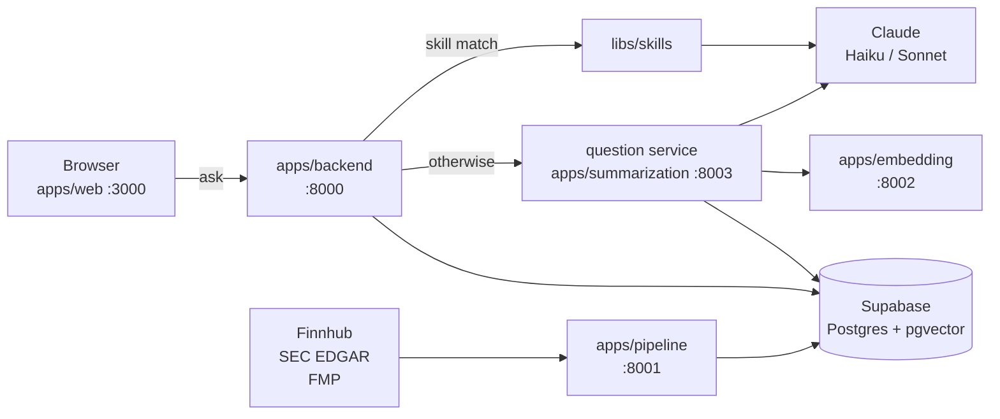

# zeroNoise

Financial research assistant: daily briefings, watchlist management, RAG-based
Q&A over SEC filings and news, and on-demand ticker research reports — powered
by Claude.

One monorepo holds every service and shared library. One `.env` configures all
of them.

## Quick start

```bash
git clone https://github.com/ZeroNoise2026/QuantAgent.git zeroNoise
cd zeroNoise
./dev.sh              # venvs + deps for every service, scaffolds .env, readiness report
$EDITOR .env          # fill in the empty credentials (see Configuration)
./dev.sh up           # start everything that has its credentials
```

Then open http://localhost:3000. `./dev.sh doctor` tells you exactly what is
still missing at any point.

## Architecture



**One chat request:** the backend authenticates the JWT, asks the skill router
whether a skill fits, and either runs the skill or proxies the question
service's RAG stream; the answer streams back over SSE and is saved to
Supabase.

**One ingestion run:** the pipeline pulls news, filings and quotes → cleans →
chunks → embeds via `:8002` → upserts into Supabase. Nothing else writes those
tables.

**Models.** Haiku 5.5 handles chat answers, routing, structured JSON, short
summaries and briefings; Sonnet 5.5 writes the offline research reports. Every
call goes through the single client in `libs/common`.

## Layout

```
zeroNoise/
├── .env.example              the one config file template (copy to .env)
├── dev.sh  deploy.sh         local stack · Cloud Run deploys
├── .github/workflows/        CI and scheduled jobs
├── docs/                     DEPLOY.md, architecture.html
├── scripts/                  check_boundaries.py
├── libs/
│   ├── common/               Claude client, Supabase client, audit log
│   ├── research/             TickerContext, build_report(), summary_cache
│   └── skills/               skill framework: registry, LLM router, built-in skills
└── apps/
    ├── web/                  React + Vite UI                         :3000
    ├── backend/              FastAPI BFF: auth, watchlist, briefings, chat   :8000
    ├── summarization/        question service (RAG Q&A) + summary CLI  :8003
    ├── pipeline/             ingestion + live-lookup API             :8001
    └── embedding/            all-MiniLM-L6-v2, 384-dim vectors       :8002
```

### Module boundaries

**Apps never import each other, and libs never import apps.** Code two apps
need goes in `libs/`; apps talk to each other only over HTTP.
`scripts/check_boundaries.py` enforces this in CI and in `./dev.sh test`.

| Lib | Used by | What it owns |
|---|---|---|
| `libs/common` | every Python app, other libs | `common.llm` (chat, streaming, retries, refusal handling, audit), `common.supabase`, `common.audit` |
| `libs/research` | backend, summarization, skills | market-data reads, `TickerContext`, report prompt, `summary_cache`, `build_report()` |
| `libs/skills` | backend, summary CLI | `Skill` base, registry, router; `generate_report`, `compare_tickers` |

## Configuration

Everything lives in **one file: `.env` at the repo root** (gitignored).
`./dev.sh setup` creates it from `.env.example`, keeping real defaults and
leaving placeholders empty. Every Python app's `config.py` loads it; the
frontend reads it through Vite's `envDir` (only `VITE_*` keys reach the
browser). In Cloud Run the same keys are injected by `deploy.sh`.

| Key | Needed by |
|---|---|
| `ANTHROPIC_API_KEY` | backend, question |
| `SUPABASE_URL` `SUPABASE_KEY` | backend, question, pipeline |
| `SUPABASE_JWT_SECRET` | backend |
| `FINNHUB_API_KEY` `FMP_API_KEY` `EDGAR_USER_AGENT` | pipeline |
| `VITE_SUPABASE_URL` `VITE_SUPABASE_PUBLISHABLE_KEY` | web |
| `LLM_MODEL` · `LLM_MODEL_SUMMARY` · `LLM_MODEL_QA` · `LLM_MODEL_CLASSIFY` | backend · reports · question (defaults in `.env.example`) |

Supabase values are under Dashboard → Project Settings → API. `SUPABASE_KEY`
is the **service-role** key — server-side only, it bypasses RLS.

```bash
./dev.sh env          # which required keys are set (values masked)
./dev.sh env pull     # new machine: fill the secrets in from GCP Secret Manager
```

## Backend API

| Method | Path | Description |
|---|---|---|
| GET | `/api/tickers` | Tickers available for the watchlist |
| GET/POST | `/api/watchlist` | Read / add |
| DELETE | `/api/watchlist/{ticker}` | Remove |
| GET/PUT | `/api/preferences` | Timezone, briefing toggle |
| GET | `/api/briefings` · `/latest` · `/by-date` · `/dates` | Briefing history |
| POST | `/api/briefings/refresh` | Generate one now for the watchlist |
| POST | `/api/chat/stream` | SSE chat — skill routing, then RAG |
| GET/DELETE | `/api/chat/sessions` | Session list / bulk delete |
| GET | `/api/chat/sessions/{id}/messages` | Session transcript |
| POST | `/api/summarize` | On-demand ticker summary |
| — | `/api/files/...` | Upload, list, preview, download, attach, delete |
| GET | `/health` | Liveness |

Every route except `/health` requires `Authorization: Bearer <supabase jwt>`.
The frontend dev server proxies `/api` to `http://localhost:8000`, so no CORS
setup is needed locally; in production set `ALLOWED_ORIGINS`.

## Data

| Tables | Written by |
|---|---|
| `documents` `earnings` `price_snapshot` `tracked_tickers` | apps/pipeline |
| `chat_sessions` `chat_messages` `user_files` `user_watchlist` `user_preferences` `daily_briefings` | apps/backend |
| `summary_cache` | libs/research |
| `api_audit_log` | libs/common |

Shared schema: `apps/pipeline/pipeline/schema.sql`. User-scoped tables and
their RLS policies: `apps/backend/migrations/`.

### One-time Supabase auth setup

1. **Authentication → Providers → Email**: enable.
2. **Authentication → Settings → Confirm email**: off for dev, otherwise users
   cannot log in until they click the confirmation mail.
3. **Project Settings → API → JWT Settings**: copy the JWT secret into `.env`
   as `SUPABASE_JWT_SECRET`.
4. Run `apps/backend/migrations/002_auth_uuid_rls.sql` in the SQL editor.
   ⚠️ It **TRUNCATEs** `chat_sessions`, `chat_messages`, `user_watchlist`,
   `user_preferences`, `daily_briefings`.

## Development

```bash
./dev.sh                 # setup + doctor (idempotent, start here)
./dev.sh setup [svc...]  # venvs, deps, editable libs, .env scaffold
./dev.sh doctor          # what is ready, what is blocked, and why
./dev.sh test            # offline suites + boundary check, zero credentials
./dev.sh up [svc...]     # start services; refuses any with missing credentials
./dev.sh down / status / logs <svc>
./dev.sh sync            # git pull --ff-only
```

Services: `embedding` `pipeline` `question` `backend` `frontend`.

- **One venv per service.** The question service pins `fastapi==0.104.1` /
  `pydantic==2.5.0`; the backend does not. Libs are installed **editable**
  into each venv that needs them, so edits take effect without a reinstall.
- **`up` refuses to start a service whose credentials are missing** instead of
  letting it die in a stack trace.
- **`.env` scaffolding never overwrites** an existing `.env`, and treats
  placeholders (`sk-xxxxxxxx`, `your-…`, `<…>`) as missing.

Running one service by hand:

```bash
cd apps/backend
python3 -m venv venv && source venv/bin/activate
pip install -r requirements.txt -e ../../libs/common -e ../../libs/research -e ../../libs/skills
uvicorn main:app --port 8000 --reload
```

Research reports from the command line:

```bash
cd apps/summarization
python -m summary.run --ticker AAPL          # cached by input hash; saved to output/
python -m summary.run --skill compare_tickers --args '{"tickers":["AAPL","MSFT"]}'
```

## Deployment

`./deploy.sh` builds every image and deploys it to Cloud Run, wiring service
URLs and mounting secrets from Secret Manager — see
[docs/DEPLOY.md](docs/DEPLOY.md). Images for services that use `libs/` build
from the repo root so the libs come from the same checkout. The web app
deploys to Vercel (`./deploy.sh frontend` prints the steps).

Not scheduled yet: the daily briefing (`apps/backend/briefing.py`) and
ingestion (`.github/workflows/pipeline-ingest.yml` is manual-only).

## Not in this repo

- **Voice assistant** — a generic, reusable module in its own repo
  (`voiceAI-plugin`); it talks to the backend over HTTP.
- **Eval harness** — being rewritten as a separate repo.
